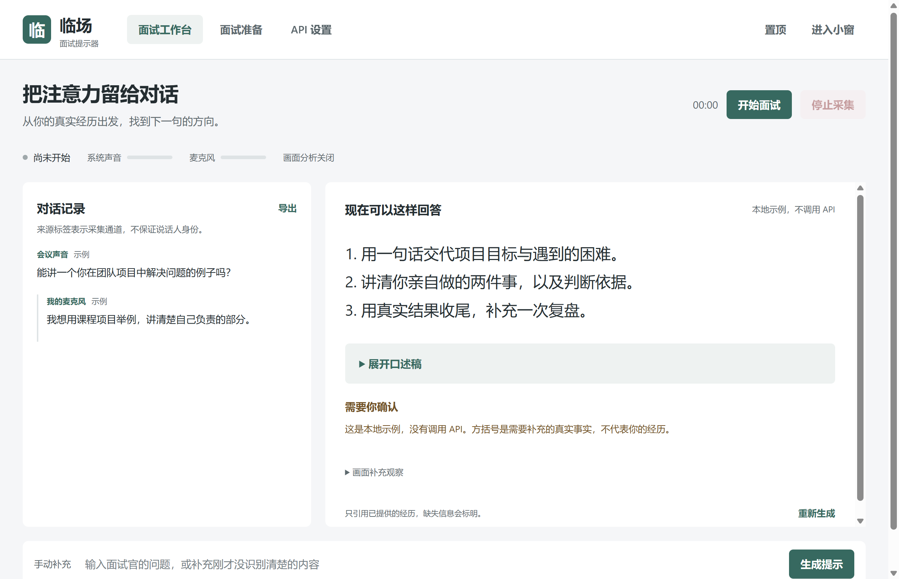

# LiveCue（临场）

<div align="center">
<a href="https://github.com/GPDdev/LiveCue/releases"></a>    
</div>

<p align="center">听清问题，说出自己的答案。</p>

Windows 桌面面试表达助手。面试前填写简历、目标岗位和个人想法；面试时将会议声音转为文字，结合真实经历生成回答要点与口述稿。支持自带 OpenAI 兼容 API，以及可选的会议画面观察。

[下载 Windows 便携版](https://github.com/GPDdev/LiveCue/releases/latest) / [报告问题](https://github.com/GPDdev/LiveCue/issues)



> [!NOTE]
> 截图来自不调用 API 的本地示例。LiveCue 根据你提供的资料辅助组织表达，输出仍需核实；画面功能描述可见事实，无法可靠识别真实心情或意图。请遵守面试或会议对录制、数据处理和辅助工具的约定。

## 目录

- [功能](#功能)
- [安装](#安装)
- [使用](#使用)
- [API 配置](#api-配置)
- [数据与隐私](#数据与隐私)
- [限制与故障处理](#限制与故障处理)
- [开发与验证](#开发与验证)
- [参与贡献](#参与贡献)
- [许可证](#许可证)

## 功能

| 能力 | 当前实现 |
| --- | --- |
| 面试准备 | 填写简历、岗位要求和表达偏好，支持中文与英文回答 |
| 简历导入 | 粘贴文字，或导入 TXT、Markdown 文件 |
| 声音采集 | Windows 系统播放声音与可选麦克风独立转写，记录采集来源和时间 |
| 回答提示 | 会议转写触发流式回答，显示要点、可展开口述稿与待确认信息 |
| 画面观察 | 默认关闭，开启后定时发送所选窗口或屏幕的截图 |
| 自带 API | 回答、语音转写和视觉分别配置地址、Key 与模型，也可让视觉沿用回答配置 |
| 面试工作台 | 置顶、小窗、手动补充问题、重新生成提示、导出对话和最近一次回答 |
| 本地存储 | 准备内容和 API 配置可使用系统加密保存，也可仅在本次运行使用 |

## 安装

### Windows 便携版

1. 打开 [Releases](https://github.com/GPDdev/LiveCue/releases/latest)，下载 `InterviewHelper-0.1.0-x64.exe`。
2. 在 Windows 10/11 x64 上双击运行，不需要安装 Node.js。
3. 首次启动需要解压运行文件，请稍候。

当前便携版未进行数字签名。程序启动后显示中文名称“临场面试提示器”。

### 从源码运行

需要 Windows 10/11 x64，以及 Node.js 22.12 或更新版本。

```powershell
git clone https://github.com/GPDdev/LiveCue.git
cd LiveCue
npm ci
npx --no-install install-electron --no
npm start
```

Electron 运行文件需要下载。若安装或首次运行失败，请先检查 npm 和 Electron 下载源的网络连通性。

## 使用

1. **准备资料。** 在“面试准备”填写简历、目标岗位和个人想法，选择回答语言并保存。PDF、Word 请复制其中的文字后粘贴。
2. **配置 API。** 在“API 设置”填写回答与转写的 Base URL、模型名和 API Key。若需要分析画面，选择支持图片输入的模型。保存后可分别测试接口，测试可能产生少量费用。
3. **先试一个问题。** 在工作台手动输入问题，检查模型能否正常返回提示。也可点击“体验本地示例”，无需配置 Key，该入口不调用 API。
4. **开始采集。** 点击“开始面试”，选择会议窗口或屏幕。麦克风默认开启，可以取消；画面分析默认关闭，需要时再勾选。
5. **参考提示。** 先阅读回答要点，再按需展开口述稿。可以置顶、切换小窗，或手动补充识别不完整的问题。
6. **结束并导出。** 点击“停止采集”。需要保留记录时点击“导出”，保存对话与最近一次提示。关闭程序后，未导出的对话不会恢复。

生成提示时会使用已保存的准备内容和最近 50 段对话。修改资料或配置前，需要先停止采集。

## API 配置

三个能力可以使用不同服务商。程序直接请求你配置的接口，不经过项目作者的业务服务器。

| 配置项 | 填写方式 |
| --- | --- |
| Base URL | 服务商的 API 根路径，例如 `https://<YOUR_API_HOST>/v1`，不要追加具体接口名 |
| 模型名 | 服务商提供的准确模型 ID，例如 `<YOUR_CHAT_MODEL>`、`<YOUR_ASR_MODEL>` |
| API Key | 你自己的 `<YOUR_API_KEY>`；本机无鉴权服务可以留空 |
| 视觉沿用回答配置 | 开启后使用回答接口的地址、Key 和模型，该模型必须支持图片 |
| 保存到本机 | 将准备内容和 API 配置加密保存；取消后删除已有持久化配置，仅本次运行有效 |

### 兼容接口

| 能力 | 接口 | 请求与响应 |
| --- | --- | --- |
| 回答 | `POST {Base URL}/chat/completions` | 发送 `model`、`messages`、`stream`、`max_tokens`；支持 SSE `choices[].delta.content`，也兼容 JSON `choices[].message.content` |
| 语音转写 | `POST {Base URL}/audio/transcriptions` | multipart 上传单声道 PCM16 WAV，含 `file`、`model`、`response_format=json`；响应须含 `text` |
| 画面分析 | `POST {Base URL}/chat/completions` | 使用多模态 `messages`，含 JPEG data URL 的 `image_url` 与 `detail=low` |

远端 API 必须使用 HTTPS。本机 `localhost`、`127.0.0.1`、`[::1]` 可以使用 HTTP。地址不能包含内嵌账号密码、查询参数或片段，请求不跟随重定向。

Key 保存后不会回填到界面。同一 Base URL 下留空可继续使用已有 Key；修改地址后须重新填写，避免将原服务的 Key 发送到新地址。

> [!IMPORTANT]
> 文本接口可用不代表服务商同时提供语音转写或图片输入。默认模型名只是示例，请按服务商实际支持的模型修改。当前不适配仅提供 Responses API、专有 WebSocket 转写协议等服务。

## 数据与隐私

| 数据 | 发送位置 | 本地保存 |
| --- | --- | --- |
| 简历、岗位、想法和最近对话 | 回答 API | 准备内容可选择加密保存；对话只保存在内存，除非主动导出 |
| 有声音的音频分块 | 语音转写 API | 不默认保存音频文件 |
| 所选画面的截图 | 开启画面分析时发送到视觉 API | 不默认保存截图文件 |
| API Key | 发送到对应服务商，用于鉴权 | 主进程持有，可使用系统加密保存 |
| 导出的对话与最近提示 | 用户选择的本机文件 | 明文 TXT，由用户自行管理 |

选择保存到本机时，配置文件为 Windows 应用数据目录下的 `settings.enc`，使用 Electron safeStorage 加密。系统加密不能隔离同一 Windows 用户权限下的所有程序。可以在设置页清除已保存的准备内容和 API 配置。

停止采集会释放设备、取消进行中的请求并丢弃未完成的音频分块。已经发送给服务商的数据无法撤回，取消也不能保证免除已发生的计费。清除本机配置不会删除已导出的文件或服务商持有的数据。

系统播放声音包含电脑上其他程序的声音，不局限于所选会议窗口。建议使用耳机，减少麦克风重复收到扬声器声音。项目不提供账号、云同步、后台自动录制或使用统计上传。

## 限制与故障处理

- **提示存在延迟。** 音频约每六秒分块，静音分块不上传；实际等待还包括转写和回答服务的响应时间。固定边界可能截断句子，停止时不补传尾段。
- **来源标签不等于说话人身份。** 系统声音与麦克风仅表示采集通道，当前没有说话人识别。
- **画面是间隔观察。** 开启后立即尝试一帧，此后每 20 秒一帧，截图宽度不超过 960 像素。最小化窗口可能使画面冻结；单帧不能代表完整动作变化。超过一分钟的观察不用于新回答。
- **接口失败会显示通知。** 每次请求最多等待 45 秒；转写连续失败三次或队列积压超过三段时停止采集。视觉失败会暂停截图上传，音频采集继续。检查配置后可重新开始。
- **兼容范围有待实机验证。** 当前仅提供 Windows x64 版本；真实模型准确率、费用与延迟，以及各会议软件和音频设备的兼容性，需要自行试用确认。

<details>
<summary>常见 API 错误</summary>

| 状态码 | 优先检查 |
| --- | --- |
| 401 / 403 | Key、模型权限和服务商访问权限 |
| 404 | Base URL 是否多写了接口路径，模型和接口是否存在 |
| 413 | 服务商的上传大小限制 |
| 429 | 余额、配额和请求频率 |
| 超时 / 网络失败 | API 地址、网络、服务状态与代理配置 |

</details>

## 开发与验证

使用 Electron 和原生 HTML、CSS、JavaScript。当前没有前端框架，也没有应用运行时第三方业务依赖。

```text
src/
  main.cjs          主进程、加密配置、IPC、API 调用与窗口管理
  preload.cjs       限定的主进程与界面桥接接口
  api.cjs           转写、流式回答、视觉请求与提示词
  audio.mjs         WAV 编码与音频采集
  pcm-worklet.js    六秒分块与静音门限
  renderer.mjs      工作台、准备、设置和采集状态
  index.html        页面结构
  styles.css        界面样式
test/               单元测试与 Electron 桌面测试
```

```powershell
npm test
npm run test:ui
npm run dist
```

`npm run dist` 生成 Windows x64 便携版，输出到 `dist/`。

2026-11-20 本机验证结果：11 项单元测试和 6 项 Electron 桌面测试通过；便携版独立启动与本地示例已验证。上述徽章记录本机检查结果，不代表持续集成状态。

单元测试覆盖 WAV、静音门限、API 路径、Key 保留规则、转写上传、SSE 边界、取消、错误与视觉请求。桌面测试使用合成音画和本机模拟 API，覆盖资料保存、加密重启恢复、双通道采集、可选画面、停止设备、配置清除及旧回答隔离，不采集真实会议、不调用收费 API。

测试数据、日志、依赖、构建输出和本地交接文件均不纳入 Git 提交。应用使用渲染进程沙盒、上下文隔离、CSP、限定 IPC 与文本渲染。

## 参与贡献

欢迎通过 [Issues](https://github.com/GPDdev/LiveCue/issues) 提交可复现的问题或改进建议。报告问题时请说明 Windows 与应用版本、采集模式、服务商接口类型、复现步骤和错误信息。请勿提交 API Key、真实简历、会议录音或含个人资料的日志。

提交修改前运行相关测试。新增 API 适配、采集方式或保存行为时，请同步说明接口要求、数据去向和验证范围。

## 许可证

当前尚未指定项目许可证，仓库暂不提供 `LICENSE` 文件。
